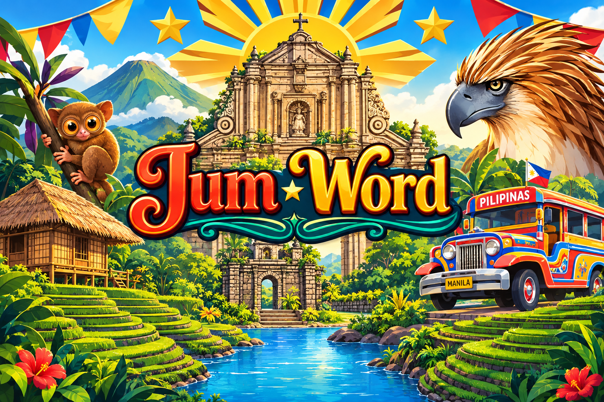

# JUMWORD



**JUMWORD** is a Java Swing word-unscrambling game set in the Philippines. Each round shows a set of jumbled letter tiles and a clue; type the correct city or province before the timer runs out. Questions are grouped into three regional difficulty tiers: **Luzon**, **Visayas**, and **Mindanao**.

The game is built with plain Java and Swing. It has no external dependencies or build-tool requirements.

---

## Table of Contents

- [Features](#features)
- [Gameplay](#gameplay)
- [Scoring and Coins](#scoring-and-coins)
- [Power-Ups](#power-ups)
- [Difficulties and Unlocks](#difficulties-and-unlocks)
- [Application Flow](#application-flow)
- [Getting Started](#getting-started)
- [Project Structure](#project-structure)
- [Data Files](#data-files)
- [Assets and Audio](#assets-and-audio)
- [Customizing the Game](#customizing-the-game)
- [Troubleshooting](#troubleshooting)

---

## Features

- Three regional difficulty tiers covering Luzon, Visayas, and Mindanao
- An 8-minute run timer and a 3-heart life system
- Coin rewards, answer combos, and five purchasable power-ups
- Letter tiles that automatically reshuffle every 5 seconds
- Progress-based difficulty unlocking with per-player best percentages
- Persistent Top-20 leaderboard
- Pause menu, in-game shop, and background-music toggle
- Resizable Swing windows with custom-drawn backgrounds and controls
- JAR-safe asset and sound loading

---

## Gameplay

### Objective

Unscramble the answer and type it into the input box. Complete all questions in a run to win. The run ends early if the timer reaches zero or all three hearts are lost.

### Rules at a Glance

| Rule | Detail |
| --- | --- |
| Time limit | 8:00 (480 seconds) per run, shared across all questions |
| Lives | 3 hearts at the start of each run |
| Rounds | Up to 40 questions per run, depending on the difficulty |
| Correct answer | Advances to the next question and increases the score by 1 |
| Wrong answer | Costs 1 heart and resets the answer combo |
| Shield | Blocks the next wrong answer instead of losing a heart |
| Tile reshuffle | The jumbled tiles are re-randomized every 5 seconds |
| Win condition | Answer every question in the run before time or hearts run out |
| Lose condition | Timer reaches 0 or hearts reach 0 |

Answers are compared case-insensitively. Spaces and punctuation are ignored, so `SAN JOSE DEL MONTE`, `sanjosedelmonte`, and `San Jose Del Monte` are all accepted.

### Controls

| Action | Input |
| --- | --- |
| Enter an answer | Type in the answer box and press **Enter** or click **GO** |
| Pause / resume | Press **Esc** or click the pause button |
| Open the shop | Click the shopping-cart button during a game |
| Toggle background music | Click the speaker button on the main menu |
| Read the instructions | Click the **?** button on the main menu |

The timer pauses while the game is paused or the shop is open.

---

## Scoring and Coins

Your **score** is the number of questions answered correctly. Your **coins** are a per-run currency used in the shop and are not carried between runs.

| Event | Score | Coins |
| --- | --- | --- |
| Correct answer | +1 | +10 |
| Every third consecutive correct answer | — | +5 bonus |
| Correct answer with **2× Coin** active | +1 | +20 instead of +10 |
| Wrong answer | — | Combo resets |

The 2× Coin bonus applies to the next correct answer only. A combo bonus can stack with it.

---

## Power-Ups

Open the shop during a run by clicking the shopping-cart button. The timer stops while the shop is open.

| Power-Up | Price | Effect |
| --- | ---: | --- |
| **Double Heart** | 100 | Restores 1 heart. If hearts are already full, the purchase is refunded. |
| **Hint** | 25 | Reveals the first letter of the current answer. |
| **Time Freeze** | 50 | Adds 30 seconds to the run timer, capped at the full 8:00. |
| **Shield** | 75 | Blocks the next wrong answer. It is consumed after blocking. |
| **2× Coin** | 200 | Doubles the coins earned from the next correct answer. |

---

## Difficulties and Unlocks

| Mode | Region | Questions | Unlock Requirement |
| --- | --- | ---: | --- |
| **Easy** | Luzon and Metro Manila | 40 | Available immediately |
| **Medium** | Visayas | 39 | At least **80%** best completion on Easy |
| **Hard** | Mindanao | 40 | At least **60%** best completion on Medium |

The game tracks each player's best completion percentage for every difficulty. Unlock checks use those stored best results, so a single strong run is enough to unlock the next tier. Locked difficulties show a progress bar with the current requirement.

---

## Application Flow

```text
Main menu
   ├─ Start Game -> Enter player name -> Choose difficulty -> Game
   │                                                ├─ Shop
   │                                                ├─ Pause (Esc)
   │                                                └─ Game-over / win screen
   └─ Leaderboard -> Top 20 scores
```

All post-game paths return to the main menu, and completed runs are saved automatically to the leaderboard and progress tracker.

---

## Getting Started

### Requirements

- **JDK 8 or newer** (a full JDK, not just a JRE)
- Windows, macOS, or Linux with a graphical desktop
- Java Sound support for background music and sound effects
- No external libraries, Maven, or Gradle

### Run from Source

From the project root:

```bash
javac -encoding UTF-8 *.java
java Main
```

Run the game from the project root so that the `assets/` and `sounds/` folders can be found. The save files are also written to the current working directory.

> **Windows note:** if your shell does not expand `*.java`, compile using an argument file instead:
>
> ```bat
> dir /b *.java > sources.txt
> javac -encoding UTF-8 @sources.txt
> java Main
> ```

### Build a Runnable JAR (Optional)

```bash
mkdir build
javac -encoding UTF-8 -d build *.java
cp -r assets build/
cp -r sounds build/
jar cfe JUMWORD.jar Main -C build .
java -jar JUMWORD.jar
```

The JAR helpers (`jar -C`) and resource loading are compatible with Java 8. Run the JAR from any writable directory; the save files will be created there.

---

## Project Structure

| Path | Purpose |
| --- | --- |
| `Main.java` | Application entry point and main menu (Start, Leaderboard, sound toggle, How to Play overlay) |
| `PlayerScreen.java` | Player-name entry; remembers the last-used name |
| `MainMenu.java` | Difficulty selection with unlock indicators and progress bars |
| `GameScreen.java` | Core gameplay: timer, hearts, answer checking, tile rendering, pause menu, and end screen |
| `Shopscreen.java` | Modal power-up shop with coin purchases and toast messages |
| `LeaderboardScreen.java` | Top-20 score table, score saving, and clear-scores action |
| `Questions.java` | Question bank for Easy, Medium, and Hard |
| `Question.java` | Question data model |
| `ProgressTracker.java` | Per-player best percentages and difficulty-unlock rules |
| `SoundManager.java` | Background music and one-shot sound effects |
| `UIFactory.java` | Shared styled buttons, cards, overlays, and painting helpers |
| `AppConstants.java` | Shared colors, window defaults, and JAR-safe image loading |
| `assets/` | Backgrounds, icons, shop art, power-up icons, and letter tiles (`assets/Alphabet/`) |
| `sounds/` | WAV files for music and sound effects |
| `*.class` | Compiled output generated by `javac`; not part of the source |

---

## Data Files

JUMWORD persists data in plain-text files in the current working directory. They are created automatically when needed.

| File | Written By | Format | Purpose |
| --- | --- | --- | --- |
| `playername.dat` | `PlayerScreen` | Plain text | Remembers the last player name entered |
| `leaderboard.dat` | `LeaderboardScreen` | `name\|score\|difficulty` per line | Top-20 leaderboard |
| `progress.dat` | `ProgressTracker` | `name\|difficulty\|percentage` per line | Best completion percentage per player and difficulty |

Example `leaderboard.dat`:

```text
Maria|34|Medium
Jose|40|Easy
```

Example `progress.dat`:

```text
Maria|Easy|85.00
Maria|Medium|64.10
```

Deleting these files resets the corresponding data. The leaderboard keeps one entry per player (matched case-insensitively) and only replaces it when a new score is higher.

---

## Assets and Audio

Image loading is handled by `AppConstants.loadImage()`, which checks the classpath first and then the working directory. This lets the same code work both from source and from a packaged JAR.

- `assets/main_bg.png` — main menu and screen background
- `assets/GameScreen_bg.png` — gameplay background
- `assets/icon.png` — window icon
- `assets/menu.png`, `assets/pause_btn.png` — pause-menu artwork
- `assets/instruction-icon.png` — How to Play icon
- `assets/player_icon.png`, `assets/coin.png` — HUD icons
- `assets/shop_bg.png`, `assets/shop_logo.png` — shop artwork
- `assets/power-ups/` — icons for the five power-ups
- `assets/Alphabet/` — `A.png` through `Z.png` letter tiles
- `sounds/*.wav` — background music, button click, game start, correct/wrong answer, purchase, win, and game-over effects

Java Sound handles the bundled WAV files directly; no external audio library is required.

---

## Customizing the Game

Several gameplay values are centralized and easy to change:

| What to change | Where |
| --- | --- |
| Questions, answers, jumbled letters, and choices | `Questions.java` |
| Run duration (`TOTAL_TIME`) and starting hearts (`MAX_HP`) | `GameScreen.java` |
| Power-up names, descriptions, and prices (`ITEM_PRICES`) | `Shopscreen.java` |
| Unlock thresholds (`MEDIUM_UNLOCK_PCT`, `HARD_UNLOCK_PCT`) | `ProgressTracker.java` |
| Question totals used for completion percentages | `ProgressTracker.java` (`EASY_TOTAL`, `MEDIUM_TOTAL`, `HARD_TOTAL`) |
| Shared colors and window size | `AppConstants.java` |
| Reusable button and overlay styles | `UIFactory.java` |

When adding or removing questions, update the matching total in `ProgressTracker.java` so completion percentages and unlock progress stay accurate. The game also caps each run at 40 rounds in `GameScreen.java`.

---

## Troubleshooting

### `[Assets] Not found: ...`

The game was probably started outside the project root. Run `java Main` from the directory containing `assets/` and `sounds/`, or package both folders into the JAR as shown above.

### `[SoundManager] Could not load: ...`

The audio file is missing or the installed Java runtime cannot decode it. Confirm the file exists under `sounds/` and is a PCM WAV file. Other WAV encodings may not be supported by Java Sound.

### `javac` is not recognized

Install a JDK (8 or newer) and add its `bin` directory to your `PATH`. Verify with:

```bash
javac -version
java -version
```

### Scores or progress are not saved

The save files are written to the current working directory. Make sure the game is running from a writable folder. Check for `leaderboard.dat` and `progress.dat` after a run.

### Text appears garbled during compilation

The source contains Unicode characters and emoji. Compile with `-encoding UTF-8` as shown in the commands above.
